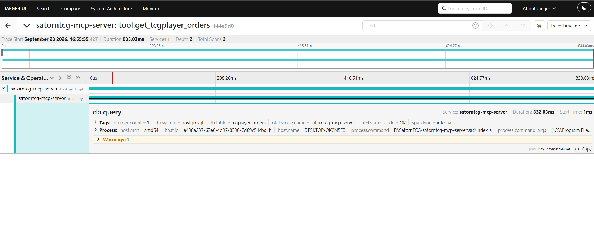

# satorntcg-mcp-server

An [MCP](https://modelcontextprotocol.io) server that exposes live TCG resale/inventory data — pricing, alerts, profit & loss, eBay listings — as tools an LLM client (Claude Desktop, Claude Code, etc.) can call directly. Instead of opening a dashboard, you can just ask: *"what's underpriced right now"* or *"how is the Gothic box performing"* and get an answer grounded in real data.

Built on top of [SatornTCG](https://satorntcg.com), a Sorcery: Contested Realm resale/content operation backed by Supabase/Postgres.

## Why this exists

This started as a resume project to learn MCP server design and observability, and turned into a tool I actually use day to day to query my own inventory and pricing data conversationally instead of clicking through a UI.

## What it exposes

| Tool | Description |
|---|---|
| `get_price_alerts` | Active price alerts, gainers/losers, stale listings, listing-price drift |
| `get_inventory_summary` | Current inventory: quantities owned/listed, latest prices |
| `get_latest_prices` | TCGplayer market price + cost basis lookup by card name |
| `get_box_pnl` | Profit & loss per box (purchase price vs. realized/unrealized pull value) |
| `get_global_pnl` | Overall business P&L across all boxes and listings |
| `get_ebay_listings` | Active or sold eBay listings |

Each tool is a thin wrapper around a Postgres view — see `src/tools/`.

## Architecture

```
Claude Desktop / Claude Code (MCP client)
        │  stdio
        ▼
  src/index.js  ── registers tools, routes tool calls
        │
        ▼
  src/tools/*.js ── one file per domain, each tool = { name, description, inputSchema, handler }
        │
        ▼
  src/supabaseClient.js ── service-role Supabase client
        │
        ▼
  Postgres (Supabase) ── views: v_active_alerts, v_inventory_dashboard,
                          v_latest_prices, v_box_pnl, v_global_pnl,
                          v_ebay_active, v_ebay_sold, v_stale_listings,
                          v_price_gainers_losers, v_listing_price_alerts
```

Every tool call is traced with OpenTelemetry, exported to Jaeger — see [Observability](#observability) below.

## Schema this expects

This server doesn't ship a demo database — it's meant to be pointed at a Postgres/Supabase project with equivalent views. If you're adapting this for your own data, the views above are just `SELECT`s over your own tables; swap the query in each `src/tools/*.js` file to match your schema. Column names referenced directly (e.g. `card_id`, `name`, `tcg_market_price`, `cost_basis`, `dismissed`) are the main thing to line up.

## Setup

```bash
git clone <this-repo>
cd satorntcg-mcp-server
npm install
cp .env.example .env
# fill in SUPABASE_URL and SUPABASE_SERVICE_KEY in .env
npm start
```

The server speaks MCP over stdio, so it's meant to be launched by an MCP client, not run standalone in a terminal for interactive use. To test with **Claude Desktop**, add it to your MCP config (`claude_desktop_config.json`):

```json
{
  "mcpServers": {
    "satorntcg": {
      "command": "node",
      "args": ["/absolute/path/to/satorntcg-mcp-server/src/index.js"]
    }
  }
}
```

Restart Claude Desktop, and the tools above become available in conversation.

## Agent runner (CLI)

`agent/run-agent.js` asks Claude one question and lets it call this server's **read-only** tools (`get_inventory_summary`, `get_latest_prices`) over MCP until it has an answer. It spawns `src/index.js` itself, so no MCP client is needed.

```bash
# .env needs SUPABASE_URL, SUPABASE_SERVICE_KEY and ANTHROPIC_API_KEY
ANTHROPIC_MODEL=claude-opus-5-5 node agent/run-agent.js "Show me my 5 most profitable cards"
```

(PowerShell: `$env:ANTHROPIC_MODEL="claude-opus-5-5"; node agent/run-agent.js "..."`)

It prints Claude's answer, then a diagnostics block with the stop reason, token counts, and each tool call (arguments, status, row count, duration). Tool output rows are never printed in diagnostics. Safeguards:

- Only the two allowlisted tools are offered. Any other tool name Claude requests is rejected without being forwarded.
- Arguments are checked against the tool's `inputSchema` from `tools/list` before `tools/call`. Unknown keys are rejected too. The server still runs its own validation.
- After 5 rounds of tool calls it stops and exits non-zero.

This queries the real Supabase project (read-only views). The loop logic is in `agent/agentCore.js` and is covered offline by `test/agent.test.js`.

## Observability

Every tool call is wrapped in an OpenTelemetry span (`tool.<name>`), with each Supabase query the tool makes nested underneath it as its own `db.query` child span. That split is the point: a slow tool call in Jaeger tells you at a glance whether the time went into the DB round-trip or into everything else the handler did (matching, mapping, duplicate-guard checks, etc.), instead of being one opaque block of latency.

Each `tool.*` span carries:

- `mcp.tool.name`, `mcp.tool.args` — which tool, called with what
- `mcp.tool.row_count` — best-effort row count from the result, when there's an obvious array to count
- `mcp.tool.duration_ms` — total handler wall time
- `mcp.tool.slow` — `true` once `mcp.tool.duration_ms` exceeds `SLOW_TOOL_THRESHOLD_MS` (1000ms, in `src/index.js`) — lets you filter straight to the calls worth looking at without eyeballing durations
- span status `OK`/`ERROR`, with the exception recorded on error

Each `db.query` child span carries `db.table` and, on success, `db.row_count`.

Traces export over OTLP/HTTP to `OTEL_EXPORTER_OTLP_ENDPOINT` (defaults to `http://localhost:4318/v1/traces`, i.e. a local collector/Jaeger — see `.env.example`). Spans are flushed on shutdown (`SIGTERM`/`SIGINT`, or the client closing the server's stdin), so a normal Claude Desktop restart doesn't lose the last few tool calls; see `src/tracing.js` for the shutdown handling and the reasoning behind its timeout.

**Shutdown timing.** The MCP server and the agent CLI both wait at most 2s (`SHUTDOWN_TIMEOUT_MS` in `src/tracing.js`) for spans, and the agent's metrics, to flush. That bounds the *wait*. It is **not a guaranteed deadline for the process to exit**:
- **On `SIGTERM`/`SIGINT`** the process calls `process.exit()` as soon as the wait ends. It exits within about 2s, and anything still being sent is dropped.
- **On a natural exit** (the CLI finishing, or the server's stdin closing), Node only exits once nothing is left running, including an export still in flight. So each trace export is capped at 1.5s, retries included (`TRACE_EXPORT_TIMEOUT_MS`; the OTLP default is 10s).
  - Jaeger hung, or answering 429/502/503/504: exit happens about 1.5s late.
  - Jaeger not running (connection refused): no delay.
  - Either way, that run's spans are lost.
- **`OTEL_EXPORTER_OTLP_TRACES_TIMEOUT` or `OTEL_EXPORTER_OTLP_TIMEOUT`** (milliseconds) replaces the 1.5s default, e.g. for a slower remote backend. A value above 2000 lets a natural exit wait that long.
- **The timeout covers every export**, including the batches the server sends every 5s while running. A local Jaeger answers in milliseconds; a batch that takes longer than 1.5s is dropped.

### Agent traces

`agent/run-agent.js` exports its own spans (service **satorntcg-agent**, same exporter setup from `src/tracing.js`), one trace per run:

```
agent.request                                   request-level attributes (table below)
├─ mcp.setup                                    server spawn + tools/list
├─ claude.messages.create                       agent.round=0, tokens, finish reason
├─ mcp.call_tool get_inventory_summary          agent.round=1, arg key names, agent.tool.status
│  └─ tool.get_inventory_summary                (satorntcg-mcp-server)
│     └─ db.query                               (satorntcg-mcp-server)
└─ claude.messages.create                       agent.round=1
```

`agent.request` attributes:

| Attribute | Value |
|---|---|
| `gen_ai.request.model` | `ANTHROPIC_MODEL` as sent |
| `agent.outcome` | `error` or `unknown` today (see below) |
| `agent.stop_reason` | Last Claude `stop_reason`, or `max_tool_rounds` |
| `agent.tool_call_count` | Tool uses Claude requested that the agent handled (executed or rejected). Same count as the diagnostics block |
| `agent.tool_round_count` | Rounds of tool execution whose results went back to Claude. Same as `Tool rounds:` in diagnostics |
| `agent.usage.input_tokens` / `agent.usage.output_tokens` | Totals across every Claude call that returned. These are `agent.*`, not `gen_ai.usage.*`, so a backend summing `gen_ai.usage.*` over spans doesn't count tokens twice |

`agent.outcome` uses only what a run actually shows:
- **`error`**: MCP setup failed, the Anthropic API returned an error, something threw, or the run hit `max_tool_rounds`. The span status is `ERROR` as well.
- **`unknown`**: everything else, including every normal `end_turn`. The agent gets back only free text, and an answer, a clarifying question ("which metric?") and a "can't do that with these tools" reply all end the same way. Classifying them would mean guessing from the text or from whether tools were called, so `answered`, `clarification` and `unsupported` are defined in `OUTCOMES` but never emitted. Emitting them needs a structured signal from the model, such as a final-response tool or output schema, which would change the agent's behavior. A run interrupted by a signal also keeps `unknown`, with an `interrupted by …` error status.
- When a run fails before the agent loop returns, the two tool counts are left unset rather than reconstructed. Token totals still cover the Claude calls that completed.

- Every span has `agent.duration_ms` and an `OK`/`ERROR` status. `agent.tool.status` is `ok`, `tool_error` (the tool returned `isError`) or `mcp_error` (the protocol call threw). Tool uses the agent rejected before calling MCP (not allowlisted, invalid arguments) appear as `tool_use_rejected` events on `agent.request`.
- Claude spans carry `gen_ai.usage.input_tokens` / `output_tokens` (plus cache read/creation tokens when present), `gen_ai.request.model`, `gen_ai.response.model` and `gen_ai.response.finish_reasons`.
- Not recorded in span attributes: the API key, the question or system prompt, message content, tool argument values, or anything from a tool result. The server's own `tool.*` span still records `mcp.tool.args` as described above.
- **Known gap:** NodeSDK's default resource detectors attach `process.command_args` to every agent trace, and for this CLI that includes the question. They also attach `process.owner`, `host.name` and `process.pid`. Metrics avoid this with their own resource (see Agent metrics). Traces still carry it.
- On Ctrl+C or `SIGTERM`, open spans are ended with an `interrupted by SIGINT`/`SIGTERM` error status and flushed before exit.
- `OTEL_SDK_DISABLED=true` turns agent tracing off.

**How the trace crosses into the server.** stdio has no headers, so the agent sends W3C `traceparent`/`tracestate` in the `tools/call` request's `params._meta`, MCP's general-purpose metadata field, and `src/index.js` extracts it as the parent of its `tool.*` span. These keys are a convention between this agent and this server, not something MCP itself defines. Limitations:
- Only `tools/call` carries context. `initialize` and `tools/list` aren't traced on the server, so `mcp.setup` has no server children.
- Clients that don't send these keys (Claude Desktop, Claude Code) get the old behavior: each tool call starts its own trace under satorntcg-mcp-server.
- Because both processes export separately, the server's spans can show up a moment after the agent's if you open the trace immediately.

### Agent metrics

`agent/run-agent.js` also records OpenTelemetry metrics (`agent/agentMetrics.js`):

| Metric | Type | Labels | Recorded |
|---|---|---|---|
| `agent.requests` | counter, `{request}` | `gen_ai.request.model`, `agent.outcome` | Once per request, whether it succeeds, fails or is interrupted |
| `agent.request.duration` | histogram, `ms` | `gen_ai.request.model`, `agent.outcome` | Same moment. Covers MCP server spawn through shutdown. Buckets 250ms–120s |
| `agent.tool.calls` | counter, `{call}` | `mcp.tool.name`, `agent.tool.outcome` (`success`/`error`) | Per MCP `tools/call`. `error` covers both an `isError` result and a failed call. Tool uses the agent rejects before MCP aren't calls and aren't counted (they show up as `tool_use_rejected` span events) |
| `agent.tokens.input` / `agent.tokens.output` | counter, `{token}` | `gen_ai.request.model` | Per Claude response, from `usage.input_tokens` / `usage.output_tokens`. Cache-read and cache-write tokens aren't included |

- `agent.outcome` is the same value as on the `agent.request` span (`error` or `unknown`; see above). An interrupted run is counted as `unknown`.
- Labels are limited to the model ID, the outcome, and an allowlisted tool name. Any other name is recorded as `other`. The question, card names, argument values and request IDs are never used as labels.
- A usage error (no question, no `ANTHROPIC_MODEL`) never starts a request, so it isn't counted.
- **Flush on exit:** in `sdk-metrics` 1.x, shutting down a `PeriodicExportingMetricReader` does *not* export what was recorded since the last 60s interval. That's every metric from a CLI run. `shutdownTracing()` in `src/tracing.js` therefore calls `forceFlush()` on the reader before shutting it down. The trace flush runs at the same time, not after it, so a slow Collector can't hold up traces. `test/agentMetrics.test.js` checks both in child processes. For how long exit can take when the Collector misbehaves, see the limitations under [Local Prometheus](#local-prometheus-opentelemetry-collector).

**Where metrics go.** Off by default. `OTEL_METRICS_EXPORTER` (the standard OTel variable) selects the exporter:
- unset / `none`: no `MeterProvider` is registered, and the instruments are no-ops.
- `otlp`: OTLP/HTTP to the local Collector in `observability/` (see below). The default URL is `http://localhost:4319/v1/metrics`; override it with `OTEL_EXPORTER_OTLP_METRICS_ENDPOINT`. The agent never derives this URL from `OTEL_EXPORTER_OTLP_ENDPOINT`, which is Jaeger's full traces URL.
- `console`: at exit, writes one JSON line per series to **stderr** (stdout stays just the answer). Use it for debugging without the stack:

  ```powershell
  $env:OTEL_METRICS_EXPORTER = "console"
  node agent/run-agent.js "What does cost basis mean?" 2> metrics.log
  Select-String "\[metrics\]" metrics.log
  ```
- anything else: prints a warning, and nothing is exported.

Jaeger is a tracing backend and has no metrics receiver, so these metrics **never appear in Jaeger**.

Metrics use their own `MeterProvider` (`src/tracing.js`), whose resource is just `service.name` plus the SDK's constant `telemetry.sdk.*` attributes. NodeSDK's auto-detected resource, which traces still use, includes `process.command_args` (the question), `process.owner`, `host.name` and `process.pid`. The Prometheus exporter would turn those into labels, and a per-run pid would make every run its own series.

### Local Prometheus (OpenTelemetry Collector)

`observability/docker-compose.yml` runs three containers, with every port bound to `127.0.0.1`:

| Service | Image | Host port | Role |
|---|---|---|---|
| `otel-collector` | `otel/opentelemetry-collector-contrib:0.161.0` | `4319` → OTLP/HTTP `4318` | Receives agent metrics (metrics pipeline only) |
| | | `8889` | Prometheus exposition of the Collector's running totals |
| `prometheus` | `prom/prometheus:v3.14.0` | `9090` | Scrapes `otel-collector:8889` every 15s |
| `grafana` | `grafana/grafana:12.2.0` | `3000` | UI over Prometheus (provisioned data source, no dashboards yet) |

**Traces don't go through the Collector.** The agent and MCP server keep exporting straight to the standalone Jaeger container on `4318` (below), which is why the Collector takes `4319`. Jaeger isn't in the Compose file, because it would collide with that container's name and ports.

**Short-lived processes and counters.** Every CLI run is a new process, and its cumulative counters start at 0. If each run exported cumulative values, the Collector would just replace the last run's `agent.requests = 1` with the next run's `1`, and the total would never grow. So the agent exports **delta** temporality, and the Collector's `delta_to_cumulative` processor adds each run onto one running series per label set. That works because the metric resource is identical for every run. Limitations:
- **The totals live in Collector memory.** Restarting the Collector, or `docker compose down`, resets them to 0. Prometheus treats that as an ordinary counter reset, and its stored history survives in the `prometheus-data` volume.
- **Idle series expire.** A series not updated for 168h (`max_stale` / `metric_expiration`) is dropped and starts again from 0 on its next run.
- **`increase()` / `rate()` are approximate here.** Prometheus extrapolates across sparse samples, and doesn't count a series' first value as an increase. Over a short window, `sum(increase(agent_requests_total[1h]))` came out as 3.2 when the true number was 1. Use them for trends. For exact counts, read the counter itself: `sum(agent_requests_total)` is the total since the Collector started.
- **Metrics from a run are lost** if the Collector is down, hung or returning errors when the run exits. Nothing is buffered on disk, and the failure is silent unless `OTEL_LOG_LEVEL=error` is set. How much later the CLI exits:
  - **Collector down** (connection refused): no noticeable delay, the export fails at once.
  - **Collector hung, or answering 429/502/503/504:** about 1.5s. The metric exporter's `timeoutMillis` (`OTLP_EXPORT_TIMEOUT_MS` in `agent/agentMetrics.js`) covers the request and its retries. The default would be 10s.
  - **Traces still reach Jaeger** in both cases, because they're flushed alongside metrics rather than after them.
- **The 2s shutdown wait isn't a process deadline** (see [Shutdown timing](#observability)). Traces and metrics time out separately and at the same time, so even with both the Collector and Jaeger hung, the CLI exits about 1.5s late.
- `delta_to_cumulative` is an **alpha** Collector component.

**Name and unit changes.** The Collector's Prometheus exporter rewrites OTel names:

| OTel metric (unit) | Prometheus series |
|---|---|
| `agent.requests` (`{request}`) | `agent_requests_total` |
| `agent.request.duration` (`ms`) | `agent_request_duration_milliseconds_bucket` / `_sum` / `_count` |
| `agent.tool.calls` (`{call}`) | `agent_tool_calls_total` |
| `agent.tokens.input` / `.output` (`{token}`) | `agent_tokens_input_total` / `agent_tokens_output_total` |

- Dots become underscores, in metric names and in labels: `gen_ai_request_model`, `agent_outcome`, `mcp_tool_name`, `agent_tool_outcome`.
- Monotonic counters get `_total`.
- Units in braces (`{request}`, `{token}`) are dropped; `ms` becomes `_milliseconds`.
- `service.name` becomes the `job` label (`satorntcg-agent`, kept by `honor_labels: true`), and `otel_scope_name` is added.
- Prometheus 3 stores histogram `le` values as floats (`"2500.0"`).

**Start, verify, stop (PowerShell, from the repo root):**

```powershell
# Start the stack (Jaeger keeps running separately)
docker compose -f observability/docker-compose.yml up -d
docker compose -f observability/docker-compose.yml ps

# Run the agent with OTLP metrics
$env:OTEL_METRICS_EXPORTER = "otlp"
node agent/run-agent.js "What does cost basis mean?"

# Wait one scrape interval (15s), then query Prometheus
Start-Sleep 20
Invoke-RestMethod "http://localhost:9090/api/v1/query?query=agent_requests_total" | ConvertTo-Json -Depth 6
Invoke-RestMethod "http://localhost:9090/api/v1/query?query=agent_tokens_input_total" | ConvertTo-Json -Depth 6

# What the Collector is currently exposing, before Prometheus scrapes it
(Invoke-WebRequest http://localhost:8889/metrics -UseBasicParsing).Content -split "`n" | Select-String "^agent_"

# Stop (add -v to also delete Prometheus' stored history)
docker compose -f observability/docker-compose.yml down
Remove-Item Env:OTEL_METRICS_EXPORTER
```

**Grafana.** Prometheus is provisioned as the default data source from `observability/grafana/provisioning/datasources/prometheus.yml`, at `http://prometheus:9090` (the Compose service name, not `localhost`, because Grafana's backend makes the request from inside its container). Log in at http://localhost:3000 as `admin` / `admin` (or `GRAFANA_ADMIN_PASSWORD`, which only applies the first time the `grafana-data` volume is created). To check the connection:

```powershell
$cred = New-Object PSCredential("admin", (ConvertTo-SecureString "admin" -AsPlainText -Force))
Invoke-RestMethod http://localhost:3000/api/datasources/uid/prometheus/health -Credential $cred   # status: OK
```

Or open http://localhost:9090 and try these queries:
- `agent_requests_total`
- `sum by (agent_outcome) (agent_requests_total)`
- `agent_tokens_input_total`
- `agent_tool_calls_total`
- `histogram_quantile(0.5, sum by (le) (agent_request_duration_milliseconds_bucket))`

After a run, each counter should have grown by that run's values. The token counters grow by the `Tokens:` line in that run's diagnostics block.

### Running Jaeger locally

Jaeger's all-in-one image accepts OTLP/HTTP on the default port this server already exports to, so no extra config is needed:

```bash
docker run -d --name jaeger \
  -p 16686:16686 \
  -p 4318:4318 \
  jaegertracing/all-in-one:latest
```

Then start the server as usual (`npm start`, launched by Claude Desktop or run directly) and make a few tool calls. Open the Jaeger UI at [http://localhost:16686](http://localhost:16686), pick **satorntcg-mcp-server** from the Service dropdown, and click Find Traces. For agent runs, pick **satorntcg-agent** instead and open an `agent.request` trace; the server's `tool.*` and `db.query` spans appear nested under the agent's `mcp.call_tool` spans.



## Security note

`SUPABASE_SERVICE_KEY` is the elevated service-role key, not the public anon key. This is safe here because the server only ever runs as a local process launched by a trusted MCP client (never in a browser bundle) — the same reasoning as using a service role key inside a Supabase Edge Function. Never commit `.env`; only `.env.example` (placeholder values) is tracked.

## Roadmap

- [ ] `suggest_listing` tool — draft an eBay listing from inventory + pricing data
- [ ] HTTP/SSE transport for remote access, alongside the local stdio transport
- [ ] Export OTel traces to a hosted backend (Honeycomb/Grafana) for a demo, in addition to local Jaeger

## License

MIT — see [LICENSE](./LICENSE).
